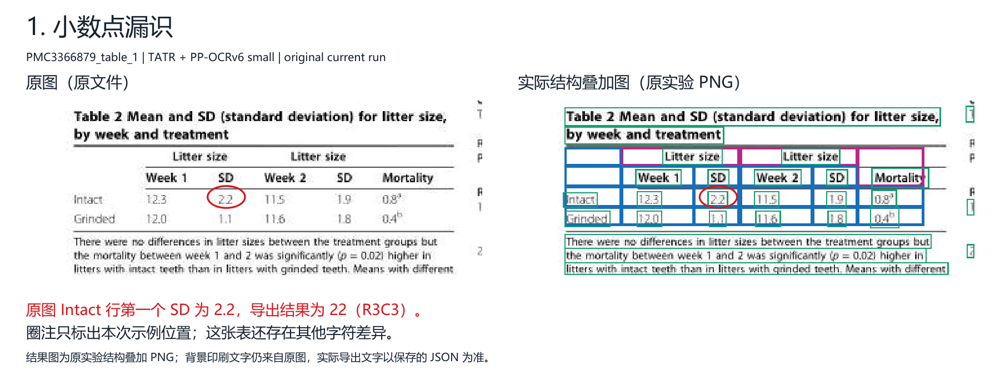
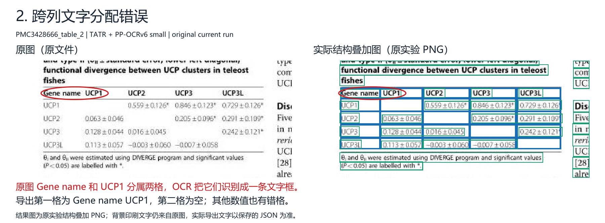
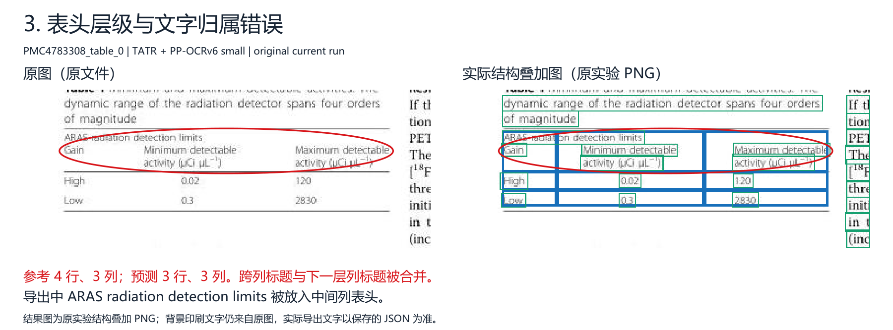

# 三张错误表格：原图与实际结果

[打开对照页面](index.html)。页面逐张展示原图、实际结构叠加图，以及原结果 HTML 中的文字表格。

下面三张均为左侧原图、右侧原实验结果 PNG，红圈标出本例关注位置。图片只添加版面、圈注和已核查的说明，没有修正任何实验预测。

| 案例 | 圈注关注位置 | 实际问题 |
|---|---|---|
| PMC3366879_table_1 | Intact 行第一个 SD（R3C3） | 原图 2.2，预测 22，小数点漏识 |
| PMC3428666_table_2 | 第一行前两列 | Gene name UCP1 被整条放入第一格，第二格为空 |
| PMC4783308_table_0 | 两层表头 | 参考 4 行，预测 3 行；跨列标题被并入下一层中列 |

结构 PNG 是原图上叠加的预测框，背景中的文字仍是原图文字。请用配套结果 HTML / JSON 核查模型最终输出文字。

12 个原图/结果文件逐字节复制，SHA-256 见 [verification.json](verification.json)。原实验、模型、评分均未改动。这三张按类型选取，不代表错误类别的总体比例。

来源和许可沿用 [千图数据来源说明](../../full-results/SOURCE.txt) 与 [数据许可](../../full-results/DATA_LICENSE.txt)。
